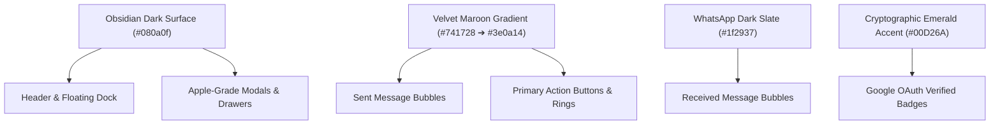

# Raoprime Institutional Design System & Figma Handoff Guide

**Product Suite:** Raoprime Client Document Portal & Messaging Suite  
**Visual Style:** Institutional Luxury Velvet Maroon & Obsidian Dark System  
**Design Level:** Apple / Telegram Grade Enterprise Architecture  
**Release Version:** v2.4.0 (Production Verified)  

---

## 1. Visual Philosophy & Foundations

The Raoprime design system blends institutional security with high-luxury consumer ergonomics. It draws aesthetic cues from high-end Swiss private banking portals and Telegram's fluid messaging physics, centered on deep Obsidian canvases, signature Velvet Maroon interactive elements, and crisp Emerald cryptographic verification accents.



---

## 2. Master Color Palette & Token Reference

### A. Brand & Interaction Colors
| Token Name | Hex / CSS Value | Description / Usage | Contrast vs Obsidian |
|---|---|---|---|
| `color-maroon-primary` | `#741728` | Primary luxury maroon accent, button fills, active input focus | 3.4:1 (Border / Accent) |
| `color-maroon-dark` | `#3e0a14` | Deep maroon shade for gradient termination & inset shadows | Background anchor |
| `color-maroon-light` | `#9e2037` | Hover state for buttons and clickable tags | 4.6:1 (AA Normal) |
| `gradient-maroon-velvet` | `linear-gradient(135deg, #741728 0%, #3e0a14 100%)` | Sent message bubbles, primary action buttons, avatar rings | Primary Brand Signature |
| `color-maroon-glow` | `rgba(116, 23, 40, 0.45)` | Elevation glow around primary CTAs and active states | Elevation |

### B. Canvas & Neutral Surfaces
| Token Name | Hex / CSS Value | Description / Usage |
|---|---|---|
| `surface-obsidian` | `#080a0f` | Global base canvas background for both desktop & mobile |
| `surface-slate-dark` | `#0d1017` | Modal cards, header bars, footer floating input dock |
| `surface-bubble-received` | `#1f2937` | WhatsApp dark slate background for incoming messages |
| `surface-card-subtle` | `rgba(255, 255, 255, 0.03)` | Card grouping panels inside modals |
| `surface-card-hover` | `rgba(255, 255, 255, 0.06)` | Hover highlight for interactive list items |
| `border-subtle` | `rgba(255, 255, 255, 0.08)` | Standard divider lines, input borders, card strokes |

### C. Semantic & Identity Accents
| Token Name | Hex / CSS Value | Description / Usage |
|---|---|---|
| `status-verified-emerald` | `#00D26A` | Google OAuth verified account checkmark, verified badge |
| `status-verified-emerald-bg` | `rgba(0, 210, 106, 0.12)` | Pill background for verified Google identity status |
| `status-warning-amber` | `#f59e0b` | Pending review indicator, unread message dot |
| `status-destructive-red` | `#dc2626` | Conversation purge button, destructive alerts |
| `status-locked-slate` | `#94a3b8` | Permanent username lock icon and badge border |

---

## 3. Typography Hierarchy

The interface utilizes the system's native high-performance san-serif typeface (`-apple-system`, `BlinkMacSystemFont`, `Segoe UI`, `Roboto`) for zero render delay and crisp typography on OLED screens:

| Style Name | Size | Weight | Line Height | Letter Spacing | Applied To |
|---|---|---|---|---|---|
| **Display Title** | `24px` | `800` (Extrabold) | `1.2` | `-0.02em` | Modal titles, Gateway branding |
| **Section Header** | `18px` | `700` (Bold) | `1.3` | `-0.01em` | Admin inbox headers, Drawer cards |
| **Body Bold** | `15px` | `600` (Semibold) | `1.4` | `0` | Message senders, action buttons |
| **Body Regular** | `15px` | `400` (Regular) | `1.45` | `0` | Message body copy, inputs |
| **Caption / Meta** | `13px` | `500` (Medium) | `1.4` | `+0.01em` | Field labels, secondary notes |
| **Micro Timestamp** | `11px` | `500` (Medium) | `1.2` | `+0.02em` | Bubble timestamps, delivery checks |
| **Monospace / Code** | `13px` | `600` (Semibold) | `1.4` | `+0.03em` | Permanent handles, IDs, hashes |

---

## 4. Core Component Specifications for Figma Recreation

### Component 1: Message Bubbles (Sent vs. Received)
- **Sent Message Bubble (Client):**
  - Geometry: `18px 18px 4px 18px` (asymmetric tail anchored bottom-right)
  - Fill: `gradient-maroon-velvet` (`#741728` to `#3e0a14` at 135°)
  - Max Width: `75%` of viewport width
  - Padding: `10px 14px`
  - Typography: Primary white text (`#ffffff`), 15px Regular
  - Footer Meta: Timestamp in `rose-200` (`#fecdd3`) at 11px + double checkmark SVG (`✓✓`)
  - Drop Shadow: `0 4px 14px rgba(116, 23, 40, 0.25)`

- **Received Message Bubble (Admin / Support):**
  - Geometry: `18px 18px 18px 4px` (asymmetric tail anchored bottom-left)
  - Fill: `surface-bubble-received` (`#1f2937`)
  - Stroke: `1px solid rgba(255, 255, 255, 0.08)`
  - Padding: `10px 14px`
  - Typography: Light slate text (`#f1f5f9`), 15px Regular
  - Footer Meta: Timestamp in `slate-400` (`#94a3b8`) at 11px
  - Drop Shadow: `0 2px 8px rgba(0, 0, 0, 0.35)`

### Component 2: My Profile Drawer Modal (`#clientProfileModal`)
- **Viewport Layouts:**
  - Mobile: Width `390px`, bottom-sheet modal anchored to bottom, `border-radius: 28px 28px 0 0`
  - Desktop: Centered card, `max-width: 480px`, `border-radius: 24px`
- **Internal Structure:**
  1. **Top Drag Pill Indicator (Mobile):** `36px × 4px` rounded bar in `rgba(255, 255, 255, 0.2)`
  2. **Velvet Header Banner:** Height `96px` with subtle radial gradient glow and close icon `✕`
  3. **Avatar Display:** Centered `72px` circular image with dual ring (`3px solid #741728` + `2px space`), showing user Google photo or initials avatar, with an overlaid Emerald checkmark pill badge
  4. **Display Name Section:** Large bold display name with an inline edit button (transitions into an edit input field with save CTA)
  5. **Permanent Username Badge (Locked):**
     - Pill background: `rgba(255, 255, 255, 0.06)`
     - Border: `1px solid rgba(255, 255, 255, 0.12)`
     - Icon: Padlock SVG in `status-locked-slate` (`#94a3b8`)
     - Label: `@username` with `[Permanent 🔒]` tag
     - Action: One-click copy button with clipboard confirmation tooltip
  6. **Google Identity Card:**
     - Unverified state: High-contrast white button with official multi-colored Google `G` icon: `"Verify & Sign in with Google"`
     - Verified state: Emerald gradient card (`rgba(0, 210, 106, 0.12)`), showing authenticated email `✉ email@domain.com` with `"Google Verified ✓"` indicator
  7. **Preferences Toggles:** Custom switch controls for message audio chimes and notifications

### Component 3: Chat Input Dock (`#chatFooter`)
- **Floating Pill Structure:** Height `56px`, width `100%`, max-width `768px` (desktop)
- **Background:** `#0d1017` with subtle stroke `1px solid rgba(255, 255, 255, 0.08)`
- **Border Radius:** `9999px` (Full pill)
- **Actions:**
  - Left Attachment: Paperclip SVG button (opens file picker dialog)
  - Left Voice: Microphone SVG button (initiates real-time audio recording)
  - Center Input: Multi-line placeholder text `"Type your message..."` in `#94a3b8`
  - Right Action: Circular `40px` Send button with `gradient-maroon-velvet` and paper plane SVG icon

### Component 4: Admin Gateway & Client Intel Telemetry Drawer
- **Admin Gateway (`#loginGateway`):** Obsidian card with Velvet Maroon emblem, master password input (`rdmy`), and instantaneous vault unlock transition.
- **Client Intel Drawer (`#clientIntelDrawer`):** Slide-over inspector panel displaying silent device telemetry: OS, Browser Engine, Resolution, GPU Renderer, Battery Level, Network Latency, and IP Geolocation.

---

## 5. Ready-to-Run Figma MCP Prompts

These prompts are calibrated for direct execution with the `figma-generate-design` and `figma-generate-library` MCP tools.

### Prompt A: Generate Full Raoprime Component Library (Design System)
```
Create an institutional design system library in Figma titled "Raoprime Design System v2.4.0".
Color Styles:
- Obsidian Canvas: #080a0f
- Slate Dark Surface: #0d1017
- Velvet Maroon Primary: #741728
- Velvet Maroon Dark: #3e0a14
- Velvet Maroon Gradient: linear-gradient(135deg, #741728, #3e0a14)
- Received Bubble Slate: #1f2937
- Google Verified Emerald: #00D26A (fill) and rgba(0, 210, 106, 0.12) (background pill)
- Muted Slate: #94a3b8

Components to Build:
1. "MessageBubble": Component with Variants:
   - Variant Sent: Velvet Maroon gradient fill, radius 18px 18px 4px 18px, white text, rose-200 timestamp at bottom right with double checkmark icon.
   - Variant Received: Slate (#1f2937) fill, 1px border rgba(255,255,255,0.08), radius 18px 18px 18px 4px, light gray text, slate timestamp at bottom right.
2. "PermanentUsernameBadge": Pill component with dark slate background, lock icon, username text in monospace, and "Permanent" indicator.
3. "GoogleAuthButton": High-contrast white button with official Google "G" icon and text "Verify & Sign in with Google".
4. "ChatInputDock": 56px height pill container (#0d1017) with attachment paperclip, microphone icon, text input placeholder, and 40px circular velvet maroon send button.
```

### Prompt B: Generate High-Fidelity Account Profile Modal
```
Generate a high-fidelity Apple/Telegram-grade modal frame named "Raoprime Client Profile Modal - Desktop & Mobile" with dimensions 480x720px on dark obsidian background (#080a0f).
Include:
1. Top ambient header banner with velvet maroon glow (#741728) and close button.
2. Centered 72px avatar with dual velvet maroon ring and emerald verified checkmark badge.
3. User name "Client Account" in 20px bold white, accompanied by an edit pencil icon.
4. Permanent handle badge: "@client" with lock icon and copy button.
5. Google Identity Card: Emerald subtle container (rgba(0,210,106,0.12)) showing verified email "raoprime.music@gmail.com" with a green shield checkmark and "Synced via Google OAuth 2.0".
6. Communication rows: Phone number field, Audio Chimes toggle switch (active state).
7. Save changes button with Velvet Maroon gradient (#741728 to #3e0a14).
```
