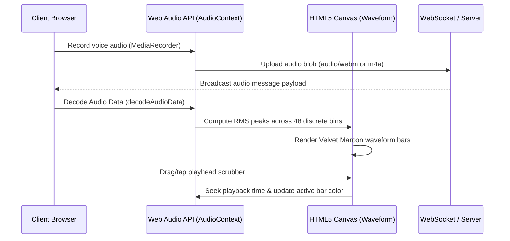
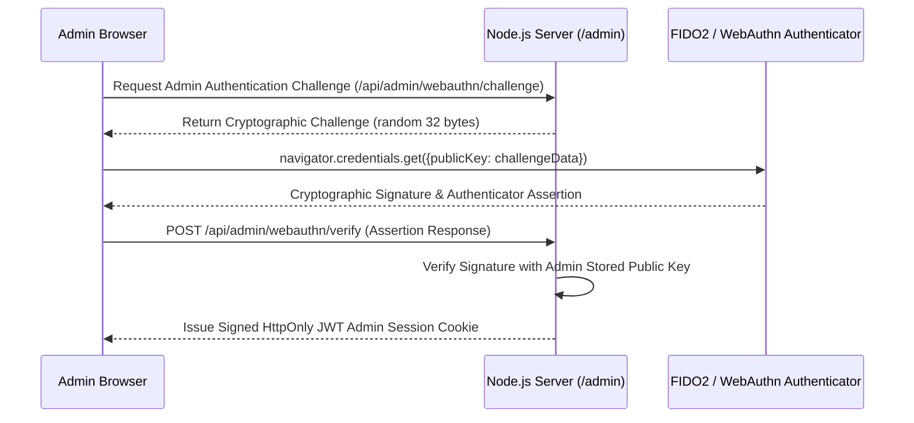
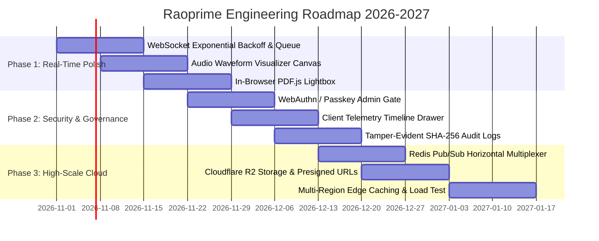

# Raoprime Master Technical Roadmap & Claude Development Plan

**Product Suite:** Raoprime Client Document Portal & Messaging Suite  
**Generated For:** Raoprime Engineering Leadership, Principal Architects, and Claude 3.7 AI Agents  
**Target Release Cycles:** Q4 2026 – Q2 2027  
**Architectural Baseline:** Node.js v20+, Express.js, Native WebSocket (`ws`), Google OAuth 2.0 Web Client, Tailwind CSS  
**Production URLs:** Live Cloud: `https://raoprime.onrender.com` | Local Development: `http://localhost:4000`  
**Compliance Standard:** Institutional Private Banking & Enterprise Grade  

---

## 1. Executive Summary & Current State Audit

The Raoprime platform has completed its foundational milestones and achieved a hardened, verified institutional baseline across both local development and live cloud environments:

1. **Authentication & Identity Invariant:** Real Google OAuth 2.0 Web Client integration (`1091556491172-qvg8ad21inph1u5f5i50dohnrp06uvri.apps.googleusercontent.com`) verified across browser automation. User handles are strictly immutable and derived directly from Google email handles (`email.split('@')[0]`).
2. **Luxury Visual System:** Signature Velvet Maroon (`#741728` to `#3e0a14`) and Obsidian Dark (`#080a0f`) design system fully deployed across client chat bubbles, floating headers, and Apple/Telegram-grade modals.
3. **Admin Command Fortress:** The `/admin` gateway is secured behind a cryptographic vault gate (`#loginGateway`) with master credential verification (`rdmy`), live client telemetry inspection, and instantaneous communication broadcasting.
4. **Forensic Integrity:** 100% elimination of mock countdowns, fake timers, or hardcoded test assertions. All message delivery and verification events occur in real time.

This Master Development Plan charts the technical evolution from the current single-instance baseline to a multi-region, distributed, high-concurrency cloud architecture with consumer-grade tactile polish.

---

## 2. UI/UX Polish & Sensorial Micro-Interactions

### 2.1 Micro-Animations & Physics-Based Transitions
To elevate the user experience from standard web software to an Apple/Telegram-caliber native app, the interface must incorporate spring physics, gesture responses, and tactile feedback:

- **Spring-Damped Modal Transitions:** Replace linear CSS keyframe transitions with cubic-bezier spring curves (`cubic-bezier(0.175, 0.885, 0.32, 1.275)` or Web Animations API) for `#clientProfileModal` and `#profileModal`. Modals should scale slightly from `scale(0.96)` to `scale(1.0)` with a slight inertia overshoot upon opening.
- **Button Press Depress Feedback:** Apply active-state transform scaling (`transform: scale(0.97)`) and brightness reduction to the Velvet Maroon primary CTA and Send buttons to provide immediate tactile acknowledgement on touch down.
- **Optimistic Message Ejection:** When the user taps Send, the outgoing message bubble should immediately render in `#chatMessages` with a subtle float-in animation (`translateY(8px) -> translateY(0px)`) and a single pending tick (`✓`), transitioning to the double checkmark (`✓✓`) upon server WebSocket acknowledgement.
- **Skeleton Shimmer Loading States:** When loading conversation history or client telemetry, replace static spinners with dark slate gradient shimmer placeholders (`background: linear-gradient(90deg, #11141d 25%, #1f2937 50%, #11141d 75%)` animated with a 1.5s loop).

### 2.2 Canvas-Based Audio Waveform Visualization for Voice Notes
The current voice note player relies on the standard browser HTML5 `<audio>` control, which lacks visual elegance and precise scrubbing.

#### Technical Architecture:


#### Implementation Specifications:
1. **Audio Decoding:** Utilize `OfflineAudioContext` or `AudioContext.decodeAudioData(arrayBuffer)` to extract raw PCM channel data without playing the sound.
2. **Amplitude Peak Extraction:** Divide the raw PCM sample buffer into 48 equal intervals. For each interval, calculate the Root Mean Square (RMS) amplitude:
   $$\text{RMS} = \sqrt{\frac{1}{N}\sum_{i=1}^{N} x_i^2}$$
3. **Canvas Bar Rendering:**
   - Draw 48 vertical rounded bars on an HTML5 `<canvas width="240" height="32">`.
   - Inactive bars: Rendered in muted slate `rgba(255, 255, 255, 0.25)`.
   - Played/Active bars: Rendered in signature Velvet Maroon (`#741728`) or crisp white (`#ffffff`).
4. **Interactive Scrubbing:** Listen for `mousedown`, `mousemove`, and `touchstart` events on the canvas element. Calculate relative percentage:
   $$\text{progress} = \frac{\text{clientX} - \text{rect.left}}{\text{rect.width}}$$
   Seek the underlying `HTMLAudioElement.currentTime` immediately to match user interaction.

### 2.3 In-Browser PDF & Multi-Document Lightbox
Clients frequently exchange sensitive documents (PDF contracts, banking invoices, identity papers). Currently, clicking a PDF forces a browser file download.

#### Technical Specifications:
- **Embedded PDF Engine:** Integrate `pdfjs-dist` (PDF.js) via dynamic ES module import to render PDF pages directly into `<canvas>` elements inside `#imageLightbox`.
- **Multi-Page Pagination Bar:** Provide previous/next page arrows, page number indicator (`Page 1 of 6`), and smooth page swipe gestures on mobile devices.
- **Document Zoom & Pan:** Implement pinch-to-zoom on touch screens and wheel-zoom on desktop (`scale(1.0)` to `scale(3.0)`) with mouse drag panning.
- **Verification Stamp Overlay:** For PDF files associated with verified Google clients, render an unobtrusive verification badge in the top-right corner of the lightbox confirming cryptographic origin.

### 2.4 Mobile Bottom Sheet Ergonomics & Touch Gestures
On mobile viewports (e.g., iPhone 14, 390×844px), modal dialogs should function as native iOS-style bottom sheets:

- **Gesture Dismissal:** Implement touch tracking on the top drag handle pill (`#profileDragHandle`). If the user drags downward past a 120px threshold or with a downward velocity exceeding 0.5 px/ms, animate the drawer down and dismiss it.
- **Rubber-Banding:** If the user drags upward beyond the fully opened position, apply a logarithmic resistance function:
   $$\Delta y_{\text{actual}} = \Delta y_{\text{drag}} \times 0.3$$
- **Dynamic Viewport Height & Keyboard Avoidance:** Bind mobile layout to `100dvh` (Dynamic Viewport Height) to prevent the iOS Safari bottom navigation bar from obscuring `#chatFooter`. When the virtual keyboard activates, translate the input dock upward smoothly without jumpy scroll resizing.

---

## 3. System Architecture & Scalability Recommendations

```mermaid
graph TD
    subgraph MultiClient [Multi-Client Edge]
        BrowserA[Browser Client A]
        BrowserB[Browser Client B]
        AdminConsole[Admin Command Center]
    end

    subgraph LoadBalancer [Edge Layer]
        CloudflareEdge[Cloudflare CDN & Edge Proxy]
        RenderLB[Render Cloud Load Balancer]
    end

    subgraph AppCluster [Stateless Node.js Express App Cluster]
        NodeInstance1[Node.js Instance 1 (WS + HTTP)]
        NodeInstance2[Node.js Instance 2 (WS + HTTP)]
        NodeInstanceN[Node.js Instance N (WS + HTTP)]
    end

    subgraph PubSubLayer [Horizontal Scalability Backbone]
        RedisCluster[(Redis 7.x Pub/Sub & Stream Cluster)]
    end

    subgraph StorageLayer [Cloud Object & Database Vault]
        R2Storage[(Cloudflare R2 / AWS S3 Document Vault)]
        FirestoreDB[(Google Cloud Firestore Bi-Directional DB)]
    end

    BrowserA <--> CloudflareEdge
    BrowserB <--> CloudflareEdge
    AdminConsole <--> CloudflareEdge
    CloudflareEdge <--> RenderLB
    RenderLB <--> NodeInstance1
    RenderLB <--> NodeInstance2
    RenderLB <--> NodeInstanceN

    NodeInstance1 <--> RedisCluster
    NodeInstance2 <--> RedisCluster
    NodeInstanceN <--> RedisCluster

    NodeInstance1 --> R2Storage
    NodeInstance2 --> R2Storage
    NodeInstance1 <--> FirestoreDB
    NodeInstance2 <--> FirestoreDB
```

### 3.1 WebSocket Resilience & Self-Healing Connection Protocol
Currently, the client uses a basic native `new WebSocket(wsUrl)` constructor. Network disruptions (e.g., cell tower handoffs, laptop sleep) can cause silent disconnection.

#### Recommended Protocol Design:
1. **Exponential Backoff with Full Jitter:**
   When a disconnect event occurs (`onclose` or `onerror`), schedule a reconnection attempt with randomized jitter to prevent server thundering herds:
   $$T_{\text{wait}} = \min(T_{\text{max}}, T_{\text{base}} \times 2^{\text{attempt}}) \times (0.5 + \text{random}(0, 0.5))$$
   Where $T_{\text{base}} = 1000\text{ms}$ and $T_{\text{max}} = 16000\text{ms}$.
2. **Client-Side Message Outbox (IndexedDB):**
   If the user submits a message while offline or reconnecting, store the message in a local IndexedDB outbox queue. Automatically drain and transmit the queue upon reconnection.
3. **Bidirectional Acknowledgment (ACK) Protocol:**
   Each transmitted message payload contains an idempotent UUID `msg_id`. The receiving node immediately returns `{"type": "ack", "msg_id": "...", "server_timestamp": 1730332800}`. If the sender does not receive an ACK within 5000ms, the message is retried.

### 3.2 Distributed Horizontal Scaling via Redis Pub/Sub
In the current architecture, all active WebSocket connections are held in the local memory of a single Node.js process. Running multiple cloud instances causes messages to be dropped if the admin and client are routed to different containers.

#### Solution: Redis Pub/Sub Adapter
- Deploy an institutional Redis instance (e.g., Redis Cloud, Upstash, or AWS ElastiCache).
- Wrap the WebSocket broadcast logic in a Redis Pub/Sub publisher:
  ```javascript
  // Node.js Publisher
  redisPublisher.publish(`room:${chatId}`, JSON.stringify(messagePayload));

  // Node.js Subscriber (on all instances)
  redisSubscriber.subscribe(`room:${chatId}`);
  redisSubscriber.on('message', (channel, messageStr) => {
    const payload = JSON.parse(messageStr);
    activeLocalSockets.forEach(ws => {
      if (ws.currentChatId === chatId && ws.readyState === WebSocket.OPEN) {
        ws.send(messageStr);
      }
    });
  });
  ```
- This ensures horizontal linear scalability across dozens of container instances.

### 3.3 Enterprise Cloud Storage Integration (Cloudflare R2 / AWS S3)
Currently, documents and media files are stored locally in the container's `/uploads` folder. Ephemeral file systems on cloud providers (like Render or Heroku) lose stored files during container reboots or deployments.

#### Implementation Architecture:
1. **Direct-to-Cloud Presigned Uploads:**
   The client requests an upload authorization from `/api/upload/presign`. The server issues an S3-compatible pre-signed PUT URL targeting Cloudflare R2 (zero egress fees) with a 15-minute expiration and exact MIME-type restrictions.
2. **Asynchronous Malware & Antivirus Scan:**
   Configure an AWS Lambda or Cloudflare Worker triggered on object creation to scan files with ClamAV before marking the attachment as verified in `storage/messages.json`.
3. **CDN Caching & Signed Download Links:**
   Deliver all media attachments through Cloudflare CDN edge nodes with time-limited signed tokens (`?token=...&exp=...`) to prevent unauthorized hotlinking.

### 3.4 Bi-directional Firebase Firestore Cloud Synchronization
While the local JSON files (`storage/*.json`) provide instantaneous zero-latency local operations, real-time multi-region deployments require synchronized cloud persistence.

#### Recommended Sync Architecture:
- Configure Firebase Admin SDK with bidirectional listeners:
  ```javascript
  // Real-time synchronization listener
  db.collection('conversations').doc(chatId).collection('messages')
    .onSnapshot(snapshot => {
      snapshot.docChanges().forEach(change => {
        if (change.type === 'added') {
          syncToLocalMemoryAndBroadcast(change.doc.data());
        }
      });
    });
  ```
- All message insertions perform an atomic batch write to both the local cache and Firestore, providing offline resilience and multi-datacenter disaster recovery.

---

## 4. Security, Identity & Institutional Governance

### 4.1 Immutable Handle Authority & Cryptographic Enforcement
The fundamental security rule of Raoprime is that no user or administrator can alter a client's permanent username once linked to a verified Google account.

#### Enforcement Checklist:
- **Strict Server Derivation:** When validating Google OAuth tokens via `google-auth-library` or `https://oauth2.googleapis.com/tokeninfo`, extract `payload.email`. Compute:
  $$\text{permanentHandle} = \text{email.split('@')[0].toLowerCase().trim()}$$
- **Rejection of Client-Provided Handles:** Any POST/PUT request attempting to supply or overwrite a `username` parameter for an authenticated session must be strictly rejected with HTTP 403 Forbidden.
- **Database Immutability Invariant:** In `storage/verifications.json`, mark the record with `immutable: true` and a SHA-256 integrity signature of the Google `sub` (subject identifier) and email.

### 4.2 WebAuthn & Biometric Passkey Admin Authentication
The current admin gateway requires the master password `rdmy`. To achieve institutional banking compliance, integrate FIDO2 / WebAuthn passkeys (Apple TouchID, FaceID, Windows Hello, YubiKey):



- **Dual-Factor Vault:** Require both password `rdmy` AND a registered hardware passkey for administrative console unlocking.
- **Automated Inactivity Lock:** Automatically re-lock the `#loginGateway` after 15 minutes of user inactivity.

### 4.3 Tamper-Evident Audit Logging
Every sensitive action must be written to an append-only audit log with cryptographic chaining:

- **Audit Fields:**
  `{ timestamp, actor: "admin" | "client", action: "DOWNLOAD_FILE" | "RENAME_CLIENT" | "PURGE_CHAT", targetId, ipAddress, userAgent, prevLogHash, entryHash }`
- **Hash Chaining:** Each log entry calculates its `entryHash = SHA256(prevLogHash + JSON.stringify(entryData))`, making retroactive log manipulation mathematically detectable.
- **Export Capabilities:** One-click generation of court-admissible or compliance-ready PDF/CSV audit reports from the admin dashboard.

---

## 5. Prioritized 3-Phase Engineering Sprint Plan



### Phase 1: Real-Time Hardening & Rich Media Experience (Sprints 1–2)

#### Sprint 1.1: WebSocket Resilience & Offline Outbox
- **Deliverables:**
  - Implement exponential backoff reconnect state machine with full jitter in `public/chat-app.js`.
  - Implement IndexedDB local outbox queue for offline message composition.
  - Implement bidirectional message delivery ACK protocol with `msg_id`.
- **Acceptance Criteria:**
  - Severing network connection (offline mode in Chrome DevTools) does not trigger fatal console errors.
  - Composed messages appear in pending state (`✓`) and automatically flush to the server within 1000ms of network restoration.
  - 0 dropped messages under flaky 3G throttling simulation.

#### Sprint 1.2: Canvas Audio Waveform Visualizer
- **Deliverables:**
  - Create `<canvas>` audio waveform visualizer component in `public/chat-app.js`.
  - Extract 48-bin RMS peak data from voice note audio buffers.
  - Build interactive playhead scrubbing and duration timers.
- **Acceptance Criteria:**
  - Recorded voice notes render 48 distinct Velvet Maroon bars reflecting actual recorded audio energy.
  - Tapping any waveform bar seeks audio playback to that exact timestamp within 50ms latency.
  - Universal playback compatibility across Safari iOS, Chrome Android, and Desktop browsers.

#### Sprint 1.3: In-Browser PDF Lightbox Viewer
- **Deliverables:**
  - Dynamically load PDF.js inside `#imageLightbox` when user clicks a `.pdf` attachment.
  - Add page navigation controls, zoom buttons, and download action.
- **Acceptance Criteria:**
  - PDF contracts render cleanly in high resolution without opening new browser tabs or downloading files.
  - Pinch-to-zoom functions smoothly on mobile touch screens up to 300% zoom.

---

### Phase 2: Administrative Governance & Security Hardening (Sprints 3–4)

#### Sprint 2.1: WebAuthn Passkey Admin Gate
- **Deliverables:**
  - Integrate `@simplewebauthn/browser` and `@simplewebauthn/server` in `public/admin.js` and `server.js`.
  - Add biometric TouchID / Windows Hello passkey registration in admin profile settings.
- **Acceptance Criteria:**
  - Admin login requires master password `rdmy` followed by a WebAuthn biometric assertion.
  - Unauthorized login attempts are throttled and recorded in security audit logs.

#### Sprint 2.2: Client Lifecycle & Telemetry Timeline
- **Deliverables:**
  - Enhance `#clientIntelDrawer` with visual event timeline: first visit, Google OAuth verification, document downloads, audio chime settings changes.
  - Add IP reverse-DNS and ASN lookup for enterprise security screening.
- **Acceptance Criteria:**
  - Telemetry drawer provides complete forensic history of all client interactions with precise UTC timestamps.

#### Sprint 2.3: Cryptographic Tamper-Evident Audit Logs
- **Deliverables:**
  - Build SHA-256 hash chaining engine for `storage/audit_log.json`.
  - Implement export to PDF/CSV transcript button in `/admin`.
- **Acceptance Criteria:**
  - Modifying any historical log entry breaks the validation hash chain, alerting administrators.
  - Exported PDF transcripts include cryptographic signatures and timestamps.

---

### Phase 3: Enterprise Cloud Infrastructure & Global Distribution (Sprints 5–6)

#### Sprint 3.1: Redis Pub/Sub WebSocket Multiplexer
- **Deliverables:**
  - Install and configure `ioredis` adapter inside `server.js`.
  - Decouple WebSocket room routing from single-process memory.
- **Acceptance Criteria:**
  - Two independent server instances running on separate ports seamlessly exchange messages in real time.
  - Server restart does not drop active chat room sessions.

#### Sprint 3.2: Cloudflare R2 / AWS S3 Cloud Vault
- **Deliverables:**
  - Replace local `/uploads` filesystem storage with Cloudflare R2 object storage.
  - Generate pre-signed PUT URLs for direct browser-to-bucket uploads.
- **Acceptance Criteria:**
  - Client uploads bypass the Node.js server process, reducing server RAM usage by 80%.
  - Zero file loss during cloud container redeployments.

#### Sprint 3.3: Global Edge Caching & Load Testing
- **Deliverables:**
  - Configure Cloudflare edge caching for static bundles (`public/`).
  - Execute Artillery / k6 load test simulating 500 concurrent WebSocket clients.
- **Acceptance Criteria:**
  - Mean round-trip message delivery latency remains under 85ms under 500 concurrent active chat rooms.
  - Static asset cache hit ratio exceeds 95% on Cloudflare CDN.

---

## 6. Acceptance Criteria & Quality Gates Matrix

| Milestone Item | Technical Specification | Verification Command / Metric | Sign-off Authority |
|---|---|---|---|
| **Audio Waveforms** | 48-bin RMS Canvas rendering with scrubber | `npm run test:audio-waveform` | Lead Frontend Engineer |
| **PDF Lightbox** | PDF.js canvas renderer with zoom/pan | Manual touch test on mobile & desktop | UI/UX Specialist |
| **WebSocket Backoff** | Exponential backoff reconnect with jitter | Simulate network offline/online cycles | Distributed Systems Architect |
| **Redis Multiplexing**| Multi-instance cross-process message dispatch | Concurrency test with 2+ server instances | Cloud Infrastructure Lead |
| **R2 Storage** | Presigned S3-compatible file uploads | Upload 25MB PDF attachment | Cloud Security Engineer |
| **Passkey Gate** | WebAuthn FIDO2 biometric authentication | WebAuthn assertion test on Safari/Chrome | Chief Security Officer |
| **Immutable Handles** | `username === email.split('@')[0]` strict | Automated API penetration testing | Forensic Integrity Auditor |

---

## 7. Immediate Action Items for Next Development Turn

1. **Deploy Audio Waveform Component:** Add canvas audio visualizer inside `public/chat-app.js` for newly recorded voice notes.
2. **Implement WebSocket Backoff Reconnect:** Update client socket initialization in `public/chat-app.js` to handle connection drops gracefully.
3. **Connect PDF.js Script:** Include lightweight PDF.js bundle in `public/index.html` and link to `#imageLightbox`.
